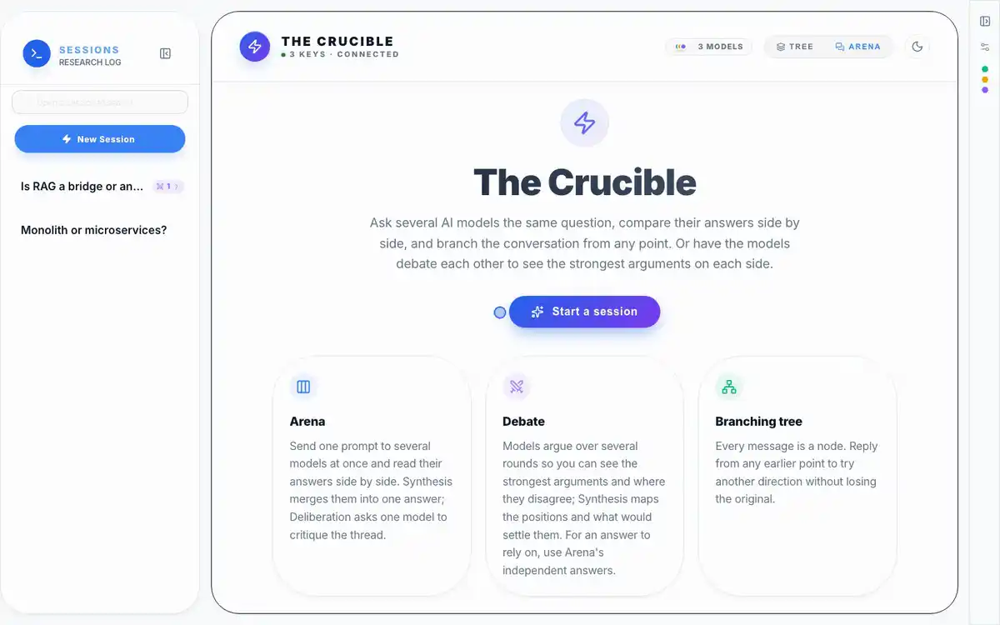

# The Crucible ⚔️

**A multi-model AI arena for branching conversations, structured debate and synthesis.**

The Crucible is a full-stack research interface for putting the same question to OpenAI, Anthropic and Google models at once. Every conversation is a **tree**: you can branch from any point, compare models side by side, have them debate each other over several rounds, and synthesize the results. It also runs headless, as a CLI and as an MCP server for other agents.



<p align="center"><em>Three models answer the same question, each continues its own conversation, one answer is argued the other way on a branch, and a synthesis merges the first answers: the tree shows all of it, and picking a reply shows its path with every turn as side-by-side cards. Then an anonymous three-model debate (Participant A/B/C, decoded in the banner) as lanes with per-round stability, one reply read in full, and the argument map it ends in — positions, what changed, what is unresolved, no verdict.</em></p>

> Recorded against sessions from `scripts/seed_demo.py`, which runs the app's own arena, synthesis and debate services; the answers are real output from GPT-6.1 Sol, Claude Sonnet 5.5 and Gemini 3.1 Pro (15 calls, about $0.14 metered on 2026-10-31).

---

## ✨ Features

| Feature | What it does |
|---|---|
| **🌳 Conversation trees** | Every message is a checkpoint. Branch from any node, edit a question and re-ask it, and navigate the whole tree on a React Flow canvas. |
| **⚔️ Arena** | Send one prompt to several models. Each answers in parallel on its own branch of the tree, for side-by-side comparison. Models get no system prompt from the app, so you compare them as they ship; set your own in **Control Panel → System prompt** and every model (and debate participant) gets it. |
| **🗣️ Debate** | An argument explorer: two or more models argue over several rounds so you can see the strongest arguments and where they disagree. Round 1 is each model's independent answer; from then on each reads the others' previous answers, labelled *Participant A, B…* rather than by model name (so no model defers to a brand). The synthesis is an argument map — positions, their best arguments and evidence, who changed position and why, what is unresolved — not a verdict. Agreement reached by debating isn't evidence: for an answer to rely on, use Arena's independent answers and Synthesis. Stop early once answers stop changing or a judge finds the models now agree, pause between rounds, add a note mid-debate, or change the topic. |
| **⚖️ Deliberation** | Ask a model to critically review the thread so far, with every earlier message attributed to the model that wrote it. |
| **🤝 Synthesis** | Combine divergent answers into one, stating where the models agree and where they don't. |
| **📎 Documents & RAG** | Attach PDF, TXT, Markdown or CSV files (up to 10 MB). With *Search my documents* on, relevant passages are retrieved and graded before the model answers, with citations. |
| **🌐 Web search** | Let models that support it use their provider's native web-search tool. |
| **🧠 Context management** | When a thread outgrows a model's budget, older history is summarized (keeping who said what) instead of being cut off — and the summary is never the only copy: for each new question a small model picks which original messages it is about and shows them again. Choose the summarizer in **Control Panel → Summarizer**, or leave it on Automatic. |
| **🔬 Compaction research tools** | Measure what summarization loses on your own models (`crucible compaction-eval`), and re-check that every piece of context machinery still beats going without it whenever models change (`crucible scaffold-audit`). See [Research](#-research-what-survives-compaction). |
| **📐 LaTeX** | `$inline$` and `$$block$$` math rendered with KaTeX. |
| **⌨️ CLI & 🤖 MCP** | Everything the web UI does to a conversation — arenas, debates, syntheses, branching, search, uploads — from the terminal or from another agent, against the same database as the web UI. |

---

## 🚀 Quick Start

### Prerequisites

- **Node.js** 24+
- **Python** 3.13+ and [**uv**](https://docs.astral.sh/uv/)
- An API key for at least one of OpenAI, Anthropic or Google

### Run locally

```bash
git clone https://github.com/imaknas/the-crucible.git
cd the-crucible

(cd backend && uv sync)          # backend dependencies
(cd frontend && npm install)     # frontend dependencies

./start_dev.sh                   # backend on :8000, frontend on :3000
```

Open **http://localhost:3000**. `start_dev.sh` picks free ports if 8000 or 3000 are taken; `Ctrl+C` stops both servers.

**API keys:** enter them in the app under **Control Panel → API Keys**, or copy `.env.example` to `backend/.env` and fill them in before starting.

<details>
<summary>Start the two servers separately</summary>

```bash
cd backend && uv run python -m app.main     # terminal 1
cd frontend && npm run dev                  # terminal 2
```

</details>

### Run with Docker

```bash
cp .env.example backend/.env     # required; add your keys now or in the app later
docker compose up --build
```

Frontend on http://localhost:3000, API on http://localhost:8000. Both are published on `127.0.0.1` only. Threads, uploads, the vector store and the embedding model (downloaded the first time you search your documents) persist in Docker volumes. `backend/.env` is mounted into the backend container, so keys set in the app are written back to it and survive a rebuild.

Other ports: `CRUCIBLE_BACKEND_PORT=8100 CRUCIBLE_FRONTEND_PORT=3100 docker compose up --build`. The backend's address is built into the frontend bundle, so rebuild after changing the backend port.

| Use | When |
|---|---|
| `./start_dev.sh` | Development: hot reload, fast restarts, easy debugging |
| `docker compose` | Trying it out or running it long-term: no local toolchain needed |

---

## 🔑 Configuration

| Variable | Required | Description |
|---|---|---|
| `OPENAI_API_KEY` | At least one* | OpenAI API key |
| `ANTHROPIC_API_KEY` | At least one* | Anthropic API key |
| `GOOGLE_API_KEY` | At least one* | Google AI API key |
| `NEXT_PUBLIC_API_URL` | No | Backend URL for the frontend (default `http://localhost:8000`). Read when the frontend is built, not when it starts |
| `HOST` | No | Backend bind address (default `127.0.0.1`) |
| `CORS_ORIGINS` | No | Extra browser origins, comma-separated. `localhost` / `127.0.0.1` on any port are always allowed. Also governs which pages may open the WebSockets |
| `ALLOWED_HOSTS` | No | Extra hostnames the API may be reached as, comma-separated (`*` allows any). `localhost`, `127.0.0.1` and `::1` are always allowed; other `Host` headers get a 400, which blocks DNS rebinding |
| `PORT` | No | Backend port (default `8000`) |
| `CRUCIBLE_RELOAD` | No | `0` turns off reloading on code changes (`python -m app.main` reloads by default; the Docker image sets `0`) |
| `DATABASE_PATH` | No | SQLite file for threads and checkpoints (default `backend/checkpoints.sqlite`) |
| `UPLOAD_DIR` | No | Where uploaded files are kept (default `backend/uploads`) |
| `CHROMA_DIR` | No | Vector store directory (default `backend/chroma_db`) |
| `CRUCIBLE_ALLOW_REMOTE_CONFIG` | No | Let non-loopback clients use the API-key endpoint. Docker Compose sets it, since it publishes on `127.0.0.1` only |

\* Keys can also be set at runtime in **Control Panel → API Keys**, which writes them to `backend/.env`. That endpoint only accepts requests from the local machine.

> **⚠️ The API has no authentication.** It listens on loopback by default. If you set `HOST=0.0.0.0` to reach it from another machine, anyone on that network can use your API keys. Reaching it under another name or IP also needs that name in `ALLOWED_HOSTS` (and the frontend's origin in `CORS_ORIGINS`).
>
> Browser pages from other sites are kept out: WebSockets and CORS accept only allowed origins, unknown `Host` headers are refused, and form, text or untyped `POST`s need an `X-Crucible-Client` header (which forces a CORS preflight). Scripts calling the REST API send JSON, or add that header to a multipart upload.

---

## ⌨️ CLI

The backend installs a `crucible` command that can do everything the web UI does to a conversation. Run it from `backend/` with `uv run`, repeat list options once per value (`-m a -m b`), and see `uv run crucible <command> --help` for every option.

**Setup**

```bash
uv run crucible models                     # model IDs, which have a key, web search and price (--all adds legacy ones)
uv run crucible keys                       # which provider keys are set (masked)
uv run crucible keys --set OPENAI_API_KEY  # asks for the value without echoing; --unset removes one
```

**Turns**

```bash
uv run crucible arena "Is P = NP?" -m gpt-6.1-sol -m claude-sonnet-5-5 -m gemini-3.1-pro-preview
uv run crucible chat "Follow-up" -m gpt-6.1-sol --thread <thread_id>
echo "question" | uv run crucible chat -m gpt-6.1-sol              # the prompt can come from stdin
uv run crucible arena "Rephrased question" -m gpt-6.1-sol -m claude-sonnet-5-5 --thread <thread_id> --from <checkpoint>
uv run crucible chat --deliberate -m claude-sonnet-5-5 --thread <thread_id>   # critically review the thread so far
uv run crucible synthesize --thread <thread_id>                    # combine the answers to the latest question
```

`arena` answers in parallel, each model on its own branch, then the first model (or `--judge`) synthesizes them; `--no-synthesize` skips that. Without `--from`, each model continues its own latest reply; `--from <checkpoint>` branches from any node of `crucible tree` (to edit a message, branch from the checkpoint before it with the new text), and `--after-debate <session>` continues from a finished debate. `chat` and `arena` also take:

- `--attach <file>` to put a file's text in this turn (`.pdf .txt .md .csv`), `--rag` to search the files uploaded to the thread, `-w` for web search;
- `--system "<prompt>"` to send every model a system prompt (none by default; `debate` and `synthesize` take it too);
- `--summarizer <model>` to choose who summarizes long history (default: the first summarizer model with a key).

**Debates**

```bash
uv run crucible debate "Topic" -m gpt-6.1-sol -m claude-sonnet-5-5 --rounds 3 --threshold 0.92
uv run crucible debates list                                       # newest first; --thread <id> for one thread
uv run crucible debates show <session_id>                          # every round of every participant, and the argument map
uv run crucible debates continue <session_id> --rounds 1 --inject "Consider the cost too"
uv run crucible debates redirect <session_id> "A new question"
uv run crucible synthesize --debate <session_id>                   # (re)write the argument map
uv run crucible debates delete <session_id>
```

Participants see each other as *Participant A, B…*; `--peers named` shows them model ids instead. `--threshold` stops once answers stop changing, `--convergence-judge <model>` once a judge finds the models agree (`--mode all|any` combines both). `--thread` and `--from` start a debate from an existing conversation. Ctrl-C stops a debate; to pause, run fewer rounds and `debates continue` later.

**Threads and history**

```bash
uv run crucible threads                                            # --rename <id> --title "…", --delete <id>
uv run crucible tree --thread <thread_id>                          # each node's checkpoint id; --open shows it in the web UI
uv run crucible messages --thread <thread_id> --at <checkpoint>    # one path, as the chat view shows it
uv run crucible search "keyword" --thread <thread_id>              # every branch
uv run crucible delete-branch <checkpoint> --thread <thread_id>    # a node and everything below it
uv run crucible upload notes.pdf --thread <thread_id>              # for --rag; --list shows what is kept
```

Every command accepts `--format json`: stdout then carries only the JSON document, errors exit 1 with the message on stderr, and option combinations that can't work exit 2 before anything runs. `crucible -v <command>` shows the backend's diagnostics on stderr. Everything the CLI creates appears in the web UI.

### Measuring context management

```bash
uv run crucible compaction-eval --estimate --scenario task -s gemini-3.8-flash --recall none --recall guided
uv run crucible compaction-eval --budget 2 --scenario task -s gemini-3.8-flash --recall none --recall guided
uv run crucible scaffold-audit --estimate          # then --budget N to run; --report for the latest verdicts
```

Every real run needs `--budget` (USD): it calibrates each model with one call, estimates the whole run, refuses to start if the estimate is over budget, and stops starting calls once the budget is spent. `--estimate` only estimates.

---

## 🔬 Research: what survives compaction?

The Crucible doubles as a testbed for one question: when a long conversation is summarized to fit the context window, which details survive, and why are the rest lost? Facts are planted in long synthetic conversations, the app's real pipeline summarizes them turn by turn, and an *oracle* checks whether each fact is still in the context — separating "the summary dropped it" from "the model didn't use it". Pilot-scale findings so far:

- **Summaries keep what the current goal needs.** After a change of plans, OpenAI and Anthropic summaries had kept only 4–13 of the 32 facts the new goal needed.
- **The cause is not knowing what comes next.** Announcing the next goal in advance restored 30 of 32; naming the subject just as often without making it next restored 6. Without that knowledge, the only fix at write time is to barely compress.
- **Deciding at read time recovers it.** Keeping the originals and fetching the relevant ones once the question is known brought back 28–32 of 32 — and the cheapest model chose what to fetch as well as the strongest.
- **With recall on, the cheapest summarizer is enough.** Its summaries plus recall kept 93/96 facts on the detail-heavy scenario (statistically equivalent to the best summarizer's 96) and 62/64 after a change of plans (the best), at about 1/25 of the cost per summary — though alone they keep less than half. Once the originals can be fetched, the summary only has to point to them. (It is now the default; pick another under **Control Panel → Summarizer**.)

The full write-up is [**What Survives Compaction?**](https://www.imaknas.com/writing/what-survives-compaction/). These are synthetic conversations at an 8,000-token threshold; the full lab notes, every number and every mistake are in [`backend/experiments/NOTES.md`](backend/experiments/NOTES.md), and the raw results in `backend/experiments/results/`.

---

## 🤖 MCP Server

The Crucible can act as a tool for other agents over the [Model Context Protocol](https://modelcontextprotocol.io). Add it to your client's MCP settings (for Claude Desktop, `~/Library/Application Support/Claude/claude_desktop_config.json`):

```json
{
  "mcpServers": {
    "the-crucible": {
      "command": "uv",
      "args": ["--directory", "/absolute/path/to/the-crucible/backend", "run", "python", "app/mcp_server.py"],
      "env": {
        "OPENAI_API_KEY": "your-key",
        "ANTHROPIC_API_KEY": "your-key",
        "GOOGLE_API_KEY": "your-key"
      }
    }
  }
}
```

Everything the web UI does to a conversation is a tool, except writing API keys (a key passed to a tool would go through the calling model's context; use `crucible keys` or the environment). All tools return structured JSON and raise an MCP error on failure. An answer always has the same shape (`model`, `model_name`, `content`, `checkpoint_id`, `error`), and every checkpoint id is a node of the conversation tree, so an id from any tool works with every other.

| Tool | Purpose |
|---|---|
| **Turns & synthesis** | |
| `invoke_arena` | Ask one or more models the same message in parallel: a chat turn (one model, `synthesize=false`), an arena turn with a synthesis, or a Deliberation (`deliberation=true`). Continues a thread (`thread_id`), branches from a node (`parent_checkpoint_id`) or from a finished debate (`after_debate_session_id`); takes `attachments` (local files), `use_rag`, `use_web_search`, `system_prompt` and `summarizer` |
| `synthesize_answers` | Combine answers already on a thread into one: by default every model's answer to the latest question, or exactly the `checkpoint_ids` given |
| **Debates** | |
| `run_debate` | Multi-round debate between two or more models (anonymous to each other unless `peer_labels="named"`), with optional early stopping (stability or a judge's agreement) and a final argument map. Can start from a node of an existing thread (`parent_checkpoint_id`); takes `attachments`, `use_rag`, `use_web_search`, `system_prompt` and `summarizer` |
| `continue_debate` | More rounds of a stopped debate, optionally injecting messages into the next round |
| `redirect_debate` | Put a new question to a debate; each model keeps what it said |
| `synthesize_debate` | Write (or rewrite) a debate's argument map from every round |
| `list_debates`, `get_debate` | Find debates, and read one aligned by round (`rounds_from` and `max_chars` keep it short) |
| `delete_debate` | Delete a debate and its lanes |
| **Threads & history** | |
| `list_threads`, `rename_thread`, `delete_thread` | Find, rename or delete threads |
| `get_thread_tree` | The conversation tree: every node with its checkpoint id, parent, model, kind and turn |
| `get_thread_messages` | Read one path of a thread; pass a `checkpoint_id` to read one model's branch |
| `search_thread` | Find messages on every branch of a thread |
| `delete_branch` | Delete a node and everything below it |
| `get_branch_answers` | The latest answer on every branch of a thread |
| `get_thread_status`, `get_thread_summary` | A thread's title, latest model and message count, latest answer and context summary |
| **Documents** | |
| `upload_document` | Upload a local file to a thread for `use_rag` searches |
| **Models** | |
| `list_models` | Model IDs, whether each has an API key, web-search support, context window and today's price |

The conversation tree's topology (checkpoints and their parent links) is also available over REST: `GET /graph/{thread_id}/topology`.

---

## 🏗️ Architecture

```
the-crucible/
├── backend/                 FastAPI + LangGraph + SQLite
│   ├── app/
│   │   ├── main.py          App assembly only (lifespan, CORS, routers)
│   │   ├── api/             HTTP & WebSocket routes — transport only
│   │   ├── services/        Behaviour: chat turns, arena, debates, synthesis, history, uploads, RAG
│   │   ├── llm/             Model providers and the ModelFactory
│   │   ├── registry.py      Which models the app offers, and the defaults
│   │   ├── catalog/         Model facts and prices from the providers' own sources
│   │   ├── compaction/      When to summarize, what to keep, what to recall (no app imports)
│   │   ├── core/            SQLite persistence, storage locations and the graph state schema
│   │   ├── cli.py           `crucible` command
│   │   └── mcp_server.py    MCP tools
│   ├── tests/               pytest suite
│   └── experiments/         Compaction lab notes, raw results, scaffold-audit history
├── frontend/                Next.js + MUI + React Flow
│   └── src/
│       ├── app/page.tsx     App shell: composes hooks and components
│       ├── hooks/           State and sockets (chat, debate session, tree, threads…)
│       ├── components/      UI (TreeCanvas, ChatView, ControlPanel sections…)
│       └── lib/             API client, pure reducers, shared types
├── e2e/                     Playwright suite and its fixture builder
└── scripts/                 Demo data and the README recording
```

- **One LangGraph workflow** handles every turn: summarize if needed → optional retrieval and grading → draft (with recalled originals when history was pruned). State lives in SQLite checkpoints, which is what makes branching from any node possible.
- **Every model in a turn is pinned to its own fork point.** By default each continues its own reply in the latest turn, so models that answered side by side keep separate conversations; branching from a node pins them all there. Pinning keeps parallel answers on their own branches instead of reading each other's half-finished turn.
- **Models come from a factory.** Each provider is a small strategy class in `backend/app/llm/providers.py`; nothing else in the code branches on the provider, and tests inject scripted models instead of patching globals.
- **Debates run per model.** Each participant gets its own sub-thread, all stream concurrently each round, and early-stop checks (stability, agreement) and how peers are presented to each other (anonymous or named) are interchangeable strategies.

[`CLAUDE.md`](CLAUDE.md) is the detailed maintainer guide: design invariants, where each kind of change belongs, and how to test it.

### Tech stack

| Layer | Stack |
|---|---|
| **Frontend** | Next.js 16, React 19, MUI 7, React Flow, Framer Motion, react-markdown, KaTeX |
| **Backend** | FastAPI, LangGraph, LangChain, SQLite, ChromaDB, tiktoken, Typer (CLI), FastMCP |
| **Embeddings** | Local HuggingFace `all-MiniLM-L6-v2` |
| **Providers** | OpenAI, Anthropic, Google (via `langchain-*`) |

---

## 🧪 Testing

```bash
(cd backend && uv run pytest tests/ -q -n 4)   # backend unit + integration, on 4 workers
(cd backend && uv run ruff check .)            # backend lint
(cd frontend && npm test)                      # frontend unit (Jest)
(cd frontend && npm run lint)                  # frontend lint

npm install && npx playwright install chromium   # once, at the repo root
npm run test:e2e                                 # end-to-end (Playwright)
```

The end-to-end suite builds its own fixture database (`e2e/seed_db.py`) and starts both servers against it with **scripted models** (`CRUCIBLE_FAKE_LLM=1`): replies stream like a real provider's, so it can send messages and run whole debates without network access or cost, and it never touches your real data. The frontend runs as a production build (`next build` into `frontend/.next-e2e`, so a dev server in the same checkout is untouched); `E2E_DEV=1 npm run test:e2e` runs it against `next dev` instead, for debugging. If ports 8123/3123 are taken, set `E2E_BACKEND_PORT` / `E2E_FRONTEND_PORT`.

<details>
<summary>Re-recording the demo</summary>

```bash
uv run --project backend python scripts/seed_demo.py --estimate   # upper bound on the cost, no calls
uv run --project backend python scripts/seed_demo.py --budget 1   # real calls, stops at the budget
cd backend && DATABASE_PATH=../scripts/.demo/demo.sqlite CHROMA_DIR=../scripts/.demo/chroma \
  uv run python -m uvicorn app.main:server --port 8200 --env-file .env &   # keys, or the header says none are set
cd frontend && NEXT_PUBLIC_API_URL=http://127.0.0.1:8200 NEXT_DIST_DIR=.next-demo npx next build \
  && NEXT_DIST_DIR=.next-demo npx next start -p 3200 &
node scripts/record_demo.mjs      # docs/demo.webp (light mode; needs ffmpeg and uv)
```

</details>

---

## 🤝 Contributing

Contributions are welcome — a new model, a better tree layout, a bug fix.

1. Create a branch: `git checkout -b feat/your-feature`
2. Make the change; [`CLAUDE.md`](CLAUDE.md) lists where each kind of change belongs. Run the tests above.
3. Commit using [Conventional Commits](https://www.conventionalcommits.org/) (`feat:`, `fix:`, `docs:`, `refactor:`, `test:`), e.g. `feat: add support for DeepSeek models`
4. Push and open a pull request.

---

## 📝 License

[MIT](LICENSE)
