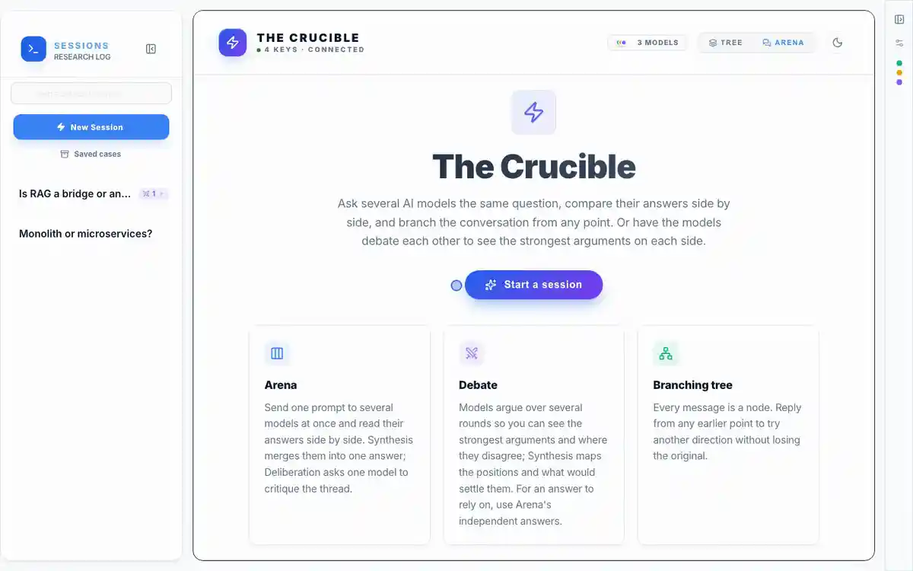

<h1 align="center">The Crucible ⚔️</h1>

<p align="center">
  <strong>Ask OpenAI, Anthropic, Google and xAI models the same question, branch the conversation anywhere, and watch them argue.</strong>
</p>

<p align="center">
  <a href="#-quick-start">Quick start</a> ·
  <a href="#-features">Features</a> ·
  <a href="docs/cli.md">CLI</a> ·
  <a href="docs/mcp.md">MCP server</a> ·
  <a href="#-research-what-survives-compaction">Research</a> ·
  <a href="docs/development.md">Development</a> ·
  <a href="docs/roadmap.md">Roadmap</a>
</p>

<p align="center">
  <a href="LICENSE"></a>
  
  
  
</p>



<p align="center"><em>Three models answer one question and each continues its own conversation; the tree shows every branch, and any path reads as side-by-side cards. Then an anonymous three-model debate, one reply read in full, and the argument map it ends in.</em></p>

The Crucible is a self-hosted workbench for comparing language models. Every conversation is a **tree**: put a question to several models at once, branch from any reply, have them debate over several rounds, and merge what they said. It runs as a web app, a CLI and an MCP server, all on the same local database. Bring your own API keys: conversations stay in a local database, and only the providers you call see them.

## ✨ Features

- 🌳 **Conversation trees.** Every message is a checkpoint. Branch from any node, or from a sentence you select in a reply; edit a question and re-ask it. On a big tree, name and bookmark branches, fold them, or compress one into a summary.
- ⚔️ **Arena.** One prompt, several models, answering in parallel. Each keeps its own conversation, and the app adds no system prompt of its own, so you compare models as they ship. Every answer shows its time to first token, tokens and cost, and you can add another model to a turn that has already been answered.
- 🔍 **Compare, combine, judge.** Diff any two answers sentence by sentence. Merge them, tabulate where they differ, keep only the parts you tick, or ask a question about them. Have the models score each other anonymously, as evidence rather than a verdict, or ask one to critique the whole thread (Deliberation).
- 🗳️ **Your own evaluation set.** Vote on the best answer, blind if you like, and see win rates by task. Save a turn as a case and replay it on next month's models: each new answer is diffed against the old one.
- 🗣️ **Debate, as an argument explorer.** Models argue over rounds as anonymous *Participant A, B…*, so none defers to a brand, or argue sides you assign, with an optional devil's advocate. It ends in an argument map (positions, evidence, who changed their mind and why, what is unresolved), never a verdict.
- 🧠 **Long conversations that keep their details.** Old history is summarized, never deleted, and the original messages a new question needs are brought back. A reply written from a summary says so, and the composer shows what the next turn will send.
- 📎 **Documents and web search.** Attach PDFs, text, Markdown or CSV; search them with cited passages; let models use their provider's own web search.
- 🔌 **Runs outlive the tab.** Close or reload the tab while models answer or debate; the server keeps going, and the tab catches up when you come back.
- ⌨️ **CLI and 🤖 MCP.** Everything the web UI does to a conversation, from the terminal or from another agent.

[Every feature in detail →](docs/features.md)

## 🚀 Quick start

You need Node.js 24+, Python 3.13+ with [uv](https://docs.astral.sh/uv/), and an API key for at least one of OpenAI, Anthropic, Google or xAI.

```bash
git clone https://github.com/imaknas/the-crucible.git && cd the-crucible
(cd backend && uv sync) && (cd frontend && npm install)
./start_dev.sh
```

Open **http://localhost:3000** and add your keys under **Control Panel → API Keys** (or copy `.env.example` to `backend/.env` first). If 8000 or 3000 is taken, `start_dev.sh` picks free ports and prints the address to open.

**With Docker:**

```bash
cp .env.example backend/.env    # required (compose mounts it); add keys now or in the app later
docker compose up --build
```

To publish other ports than 8000 and 3000, set `CRUCIBLE_BACKEND_PORT` and `CRUCIBLE_FRONTEND_PORT`. Volumes and every setting are in [docs/configuration.md](docs/configuration.md).

> [!WARNING]
> The API has no authentication. It listens on `127.0.0.1` by default; if you expose it with `HOST=0.0.0.0`, anyone who can reach it can spend your API keys. See [configuration](docs/configuration.md) for how browser access from other sites is blocked.

## ⌨️ From the terminal or another agent

The backend installs a `crucible` command:

```bash
cd backend
uv run crucible arena "Is P = NP?" -m gpt-6.1-sol -m claude-sonnet-5-5 -m gemini-3.1-pro-preview
uv run crucible debate "Monolith or microservices?" -m gpt-6.1-sol -m claude-sonnet-5-5 --rounds 3
uv run crucible tree --thread <thread_id> --open    # see it in the web UI
```

Every command takes `--format json`, and everything it creates appears in the web UI. [Full CLI reference →](docs/cli.md)

The same capabilities are MCP tools (`invoke_arena`, `run_debate`, `get_thread_tree`, `search_thread`, …), so another agent can consult a panel of models and branch their conversations. [MCP setup and tool list →](docs/mcp.md)

## 🔬 Research: what survives compaction?

The Crucible doubles as a testbed for one question: when a long conversation is summarized to fit the context window, which details survive, and why are the rest lost? Facts are planted in long synthetic conversations, the app's real pipeline summarizes them turn by turn, and an *oracle* checks whether each fact is still in the context. Pilot-scale findings so far:

- **Summaries keep what the current goal needs.** After a change of plans, OpenAI and Anthropic summaries had kept only 4–13 of the 32 facts the new goal needed.
- **The cause is not knowing what comes next.** Announcing the next goal in advance restored 30 of 32. Without that knowledge, the only fix at write time is to barely compress.
- **Deciding at read time recovers it.** Keeping the originals and fetching the relevant ones once the question is known brought back 28–32 of 32, and the cheapest model chose what to fetch as well as the strongest.
- **These hold across model generations, as directions.** Re-run with the cheapest summarizer of two generations in each family, all six kept off-goal facts less than on-goal ones, announcing the next goal brought back 30 off-goal facts across the six and lost none, and recall brought every summarizer to 45–48 of 48 (questions that name what they ask about). How large each effect is depends on the summarizer's fidelity, which follows the model, not its generation: newer was better at OpenAI and Anthropic, worse at Google (a cheaper tier).
- **A value kept is not a reason kept.** Summaries that kept a value attached to its subject dropped the reason for it (why the port changed, why the date moved) 18–89% of the time, depending on the summarizer.
- **With recall on, a cheap summarizer comes close.** Its summaries plus recall kept 93/96 facts on the detail-heavy scenario and 62/64 after a change of plans, at about 1/25 of the cost per summary. A later fix to the harness weakened this: rescored, the best summarizer stays 2–3 facts ahead, so the cheap one is the app's default on cost, not because it matched.

Some results need no language model at all, so no future model can change them: keyword recall never finds a message that shares no word with the question (by construction), and it brings a superseded value back together with its replacement.

Read the write-up, [**What Survives Compaction?**](https://www.imaknas.com/writing/what-survives-compaction/), or the lab notes with every number and every mistake in [`backend/experiments/NOTES.md`](backend/experiments/NOTES.md). You can run the same measurements on your own models with `crucible compaction-eval` and `crucible scaffold-audit` ([CLI reference](docs/cli.md#measuring-context-management)); [the benchmark guide](docs/benchmark.md) explains the scenarios, the oracles, the free runs and how long each kind of result lasts.

## ❓ FAQ

<details>
<summary><strong>Do I need keys for every provider?</strong></summary>

No. One of OpenAI, Anthropic, Google or xAI is enough, and you can add the others later in the app. With a fourth provider's key, a debate between the default three gets a referee from outside: Grok writes its argument map. `uv run crucible models` lists every model, whether its provider has a key, and its price.
</details>

<details>
<summary><strong>Why are debate participants anonymous?</strong></summary>

Models defer to majorities and to peers they recognise as strong. Labelling them *Participant A, B…* removes the brand from the argument; the UI still shows you who is who. Use `--peers named` (CLI) or the debate dialog to compare.
</details>

<details>
<summary><strong>Is the debate's conclusion reliable?</strong></summary>

Not by itself: agreement reached by debating is not evidence, which is why a debate ends in an argument map rather than a verdict. For an answer to rely on, use Arena's independent answers and Synthesis.
</details>

<details>
<summary><strong>Where is my data?</strong></summary>

In a local SQLite database (`backend/checkpoints.sqlite`), with uploads in `backend/uploads` and the document index in `backend/chroma_db`; Docker keeps them in volumes. Document search runs on a local embedding model; a model sees a file only when a turn attaches it or quotes passages retrieved from it.
</details>

<details>
<summary><strong>How do I add a model?</strong></summary>

`uv run crucible catalog-sync` checks it with a real call, then add its price and a registry entry; [`CLAUDE.md`](CLAUDE.md#extension-points) has the steps.
</details>

## 🛠️ Development

[docs/development.md](docs/development.md) covers the layout, design, tech stack, the test suites (pytest, Jest, and a Playwright suite that runs against scripted models at no cost) and how the demo above is recorded. [`CLAUDE.md`](CLAUDE.md) is the detailed maintainer guide: design invariants and where each kind of change belongs.

## 🗺️ Roadmap

The current plan grew out of a survey of about forty multi-model chat, evaluation, canvas and debate tools and the research on debate and compaction. Its six feature phases and the durable part of its research are done; what remains is optional research on how today's models behave (task continuation with real readers, vendor compaction as baselines, blind peers in debates). [The full plan →](docs/roadmap.md)

## 🤝 Contributing

Contributions are welcome: a new model, a better tree layout, a bug fix. Create a branch, make the change where [`CLAUDE.md`](CLAUDE.md) says it belongs, run the tests, and commit with [Conventional Commits](https://www.conventionalcommits.org/) (`feat:`, `fix:`, `docs:`…) before opening a pull request.

## 📝 License

[MIT](LICENSE)
